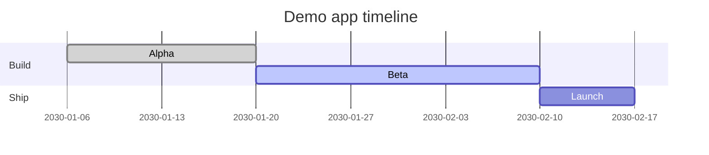

# Demo app roadmap

A made-up roadmap that shows everything the reader renders: a table, a Gantt chart, an image, links
between documents and a code block. See the [overview](../overview.md) and the
[Postgres decision](../decisions/0001-use-postgres.md#decision) for the background.

## Milestones

| Milestone | Owner  | Status      |
| --------- | ------ | ----------- |
| Alpha     | Team A | Done        |
| Beta      | Team B | In progress |
| Launch    | Team A | Planned     |

- [x] Write the plan
- [ ] Ship the beta

## Timeline



## Architecture


## Setup

```bash
# install the demo app's tools, then start it
pnpm install
pnpm --filter demo-app dev
```

```ts
export function greet(name: string): string {
  return `Hello, ${name}`;
}
```

### Tracking

The beta is tracked in [example-org/demo-app#12](https://github.com/example-org/demo-app/issues/12).
A link that leaves the documents, [like this one](../../../../outside.md), is shown as plain text.

docs-fixture-marker: demo-roadmap
